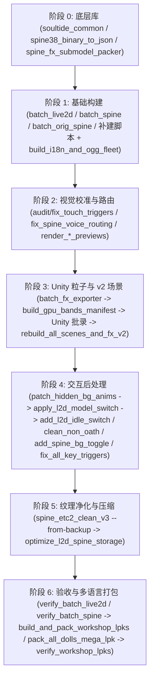

# Soul Tide Live2D & Spine Toolchain for Live2DViewerEX

面向《灵魂潮汐（Soul Tide）》全量 **55 位人偶 / 357 套皮肤（182 套 Live2D + 175 套 Spine）** 的 **Live2DViewerEX** 自动化构建、视觉校准、Unity 粒子特效重构、ETC2 纹理净化与原生多语言 `.lpk` 打包工具链。

> [!NOTE]
> **开源边界与免责声明**：本仓库**仅包含纯源码脚本（Python / C# / Unity Shader）与技术文档**，不包含任何游戏原始美术贴图、骨架、音频、数据库文件、已编译二进制（`.exe` / `.dll`）或 `.lpk` 成品包。运行构建流水线前需自行准备合法获取的本地游戏解包资源及正版 Live2DViewerEX 环境。

---

## 核心特性

- **Live2D & Spine 全量三/四语自动化管线**：只读解析游戏资产与 I18N 数据，自动组装 Live2D `.model3.json` 与 Spine 3.8 `.config.json`，支持中 / 英 / 日 / 繁原生多语言语音台词、嘴型同步、无干扰静默分页菜单与标准 Windows `VK_*` 热键。
- **Live2D 变身切换与持久化待机动作**：支持 `replace_tex` / 自包含子模型动作触发临时变身及 `change_model` 根目录主形态互切；基于 Live2DViewerEX `VarFloats["idle_mode"]` 实现跨重启持久化的全量 `standby*` + 情绪循环待机动作切换菜单。
- **v2 统一复合单骨架插层架构**：基于官方运行时 `art_prefabs.ab` + `SoulAction` 与 `SortedComponentOrder`，通过自研 [`spine38_binary_to_json.py`](core_pipeline/spine38_binary_to_json.py) 无损解码 Spine 3.8 二进制骨架并按全局 DFS `draw_key` 合入统一 `scene_back*` / `scene_front*` 复合骨架，突破 Live2DViewerEX 单皮肤 `<= 6` 子模型上限且保证零嵌套 `ClippingAttachment`。
- **60 FPS 原生骨骼粒子引擎 + Unity 2021 离线无缝录制**：将全库 **562 / 788（71.3%）** 待机粒子节点升级为 60 FPS 多骨环形相位中继原生 Spine 骨骼动画；其余复杂 Shader / 拖尾 / 3D 旋转节点通过 Unity `2021.3.34f1` 离线录制（支持 `Clamp` 贴图环绕与 `Custom1XYZW`）及零交叉淡化整数周期无缝循环方案打包。
- **隐藏背景动画与 `BoneFollower` 补全**：还原列车进站/滑门、小狗头弹跳、摩天轮水平车厢、无限帧率 3D 透视接力路灯、双骨软体权重微风桃枝等原版隐藏背景动画，并补齐骨骼跟随常驻粒子。
- **V4.4 Spine ETC2 边缘净化 & 无损 `exact=True` WebP 压缩**：清除手游 ETC2 4×4 块压缩引入的 `A=0 & RGB>0` 幽灵点、`RGB > A` PMA 违例与关节灰紫虚线，同时保护 1px 连续轮廓描边、金边与水彩薄纱；全库 PNG 纹理以 `lossless=True, exact=True` 无损转码 `.webp` 并逐像素回读断言零误差。
- **运行时背景与主骨架家具物件开关**：通过 `F3` / `H` 键支持隐藏背景但保留触摸特效；针对 38 套主骨架自带背景/家具/悬浮摆件的换装皮肤，借助 EX 原生 `slot_opacities lock/set` 提供三选一菜单。
- **原生多语言 `STD2_0` `.lpk` 角色合集打包与校验**：内置四语 `Motion.Language` 融合、跨皮肤跨引擎 `.ogg` SHA-256 去重及双层完整性校验器（55 人偶总包体压至源目录约 `54.9%`）。

---

## 六大核心底层原理

> 完整逐脚本原理、CLI 参数与执行细节请查阅 **[全量脚本核心原理、工作流程与注意事项详解](docs/script_architecture_and_guide.md)**。

1. **官方运行时场景真值 & v2 复合单骨架插层**：游戏运行时实际加载 `art_prefabs.ab` 并动态将 `SoulAction` 挂载至 `Point_Root/Spine_Scale`（而非过期的 `ui.ab` 快照）。v2 组装器按 `(SortedComponentOrder.Order 优先, -wz, global_dfs)` 全局全序拆分前后侧，并在超出 EX `<= 6` 子模型上限时调用 [`spine38_binary_to_json.py`](core_pipeline/spine38_binary_to_json.py) 无损合并 `bj_*` 骨架（保留原版无损 `.webp` 图集页与 UV，同时拆槽杜绝嵌套 `ClippingAttachment` 黑屏）。
2. **双轨混合粒子架构（原生 60 FPS + 零交叉淡化 GPU 频段）**：在 `SubEmitter` 树粒度分流待机特效——纯 2D 粒子经 Unity `ParticleSystem.GetParticles` 导出轨迹后由 [`convert_fx_to_native_spine.py`](scripts/convert_fx_to_native_spine.py) 以多骨环形相位中继 + 注水骨骼预算重构为无限/60 FPS 原生骨骼粒子；仅含拖尾、溶解/扭曲 Shader 或 3D 网格旋转的节点走 Unity 2021.3.34f1 双通道（Normal + Additive）离线录制，并以整数 tick $K$-分身叠加 / $C^1$ 双相流取代交叉淡化，彻底消除半程发暗闪烁。
3. **ETC2 4×4 边块净化（V4.4）与 `exact=True` PMA WebP**：手游 ETC2 4×4 RGB/Alpha 分离压缩会破坏 Spine Premultiplied Alpha，产生 `A=0 & RGB>0` 发光幽灵点与 `RGB > A` 杂色边；V4.4 算法通过双通道隔离锚点、Straight 亮度防黑洞门控与 1px 连续轮廓保护从原备份一手净化，随后全库贴图强制以 `lossless=True, exact=True` 转码 `.webp`（防止 `libwebp` 默认 `exact=False` 篡改透明区 RGB 在 PMA 下爆出红粉块）。
4. **Live2DViewerEX 原生持久化变量与槽位锁机制**：
   - **Live2D 待机记忆**：利用写盘变量 `CharData.varFloats["idle_mode"]`（未初始化默认 `0`），在 `Idle` 组内用 `Type: 1 (equal <k>)` 互斥隔离并由菜单末端项 `Type: 2 (assign <k>)` 切换，跨重启永久生效。
   - **Spine 主骨架物件隐藏**：利用 `slot_opacities lock <csv> 0 0` 在 `BeforeMeshUpdate` 逐帧锁死槽位透明度（无视 `ColorTimeline` 闪烁），恢复时必须使用 `slot_opacities set <csv> 1 0`（不可仅用 `unlock`，否则无透明曲线的静态槽位会永远停留在 `0`）。
5. **实证触控热区、三信号语音路由与 Windows `VK_*` 热键**：Live2D 借助 `Live2DCubismCore.dll` 校验真实 ArtMesh Drawable 规避 Part ID 错绑；Spine 借助 EX 同源 `Spine3_8` 离屏光栅化渲染真实蒙皮与 `bg_static` 边界校验；全库语音按“官方表词干 + 文件名标签 + 字幕语义”三信号防串位；按键触发统一映射为 `lwtray.exe` 轮询的标准 Win32 `VK_*` 虚拟键码。
6. **原生四语 `STD2_0` `.lpk` 融合与内容去重**：针对 EX `langPool` 非空即丢弃 `defaultPool` 的筛选规则，打包器将中/英/日三配置融合为英文兜底（`""`）+ `"zhs"` / `"zht"` / `"ja"` 严格对称结构，并将同角色（或总集包跨全部 55 角色）下 Live2D 与 Spine 共用的 `.ogg` 按 SHA-256 零重编码去重归入共享 `audio/`。

---

## 标准端到端工作流程（7 阶段）



> [!IMPORTANT]
> **全链路核心注意事项（避坑红线）**
> - **严格遵守先后依赖**：
>   1. 必须先跑 `apply_l2d_model_switch.py` 再跑 `add_l2d_idle_switch.py`，否则变身主形态无法自动继承待机菜单与贴图指令；
>   2. 每次重跑 `rebuild_all_scenes_and_fx_v2.py` 后，须衔接 `patch_hidden_bg_anims_and_bone_fx.py`（末尾自动同步 `add_spine_bg_toggle.py`）恢复隐藏背景动画与骨骼跟随粒子；
>   3. 任何配置变更后建议复跑 `fix_all_key_triggers.py` 并对修改目标执行 `--only` 定向验收后再打包 `.lpk`。
> - **Unity 离线录制切勿加 `-nographics`**：必须保留真实 GPU 渲染上下文，否则捕获帧全黑或空帧；多路并发请通过 `--unity-workers` 使用物理隔离工程避免工程锁冲突。
> - **音频仅限 Vorbis `.ogg`**：Live2DViewerEX 未携带 `bassopus.dll`，严禁转码 `.opus`。
> - **ETC2 净化务必 `--from-backup`**：始终从原始图集一手重算，避免多代叠加导致描边衰减。
> - **WebP 严守 `lossless=True, exact=True`**：并执行逐张 `np.array_equal` 断言，防止 PMA 贴图发红或出现灰条纹。
> - **增量改动用 `--only`**：单套或小批量修改时使用 `verify_batch_spine.py --only "角色/皮肤"` / `verify_batch_live2d.py --only "角色/皮肤"`，无需全库扫盘。

---

## 仓库目录结构

```text
soultide-live2d-spine-tools/
├── README.md                              # 项目说明、核心原理与工作流总览
├── core_pipeline/                         # 上游核心构建、渲染、热区校准与验收引擎（29 个脚本）
├── unity_fx_recorder/                     # Unity 2021.3.34f1 粒子离线录制 C# 编辑器与双通道 PMA Shader
├── scripts/                               # 主力生产、v2 重构、粒子引擎、ETC2 净化与 LPK 打包脚本（25 个脚本）
├── research_archive/                      # 研发过程专项诊断、逆向探针与算法原型（01~05，共 199 个脚本）
│   ├── 01_heling_and_particle_fx/         # 方案一原生 Spine 粒子重构与全库 FX/Shader 普查
│   ├── 02_texture_degauze_rebake/         # 纹理去纱、AI 贴图反 UV 烘焙与色彩/边缘精修
│   ├── 03_etc2_edge_denoise_rd/           # ETC2 4×4 压缩块诊断工具与 V1~V3.3 算法原型
│   ├── 04_ex_engine_reverse_lpk/          # Live2DViewerEX 运行时探针、LPK 哈希与 WebP/PMA 分析
│   └── 05_hitarea_align_audit/            # Live2D .moc3 触控盒与 Spine 热区/布局专项审计
└── docs/
    ├── script_architecture_and_guide.md   # 全量脚本核心原理、工作流程与注意事项深度手册
    ├── troubleshooting_manual.md          # 46 项工程排障与避坑手册（Live2D / Spine / Unity FX / LPK）
    └── workshop_55_dolls_index.md         # Steam 创意工坊 55 人偶独立合集发布索引
```

---

## 核心脚本速查

> 每个脚本的内部函数机制、CLI 参数清单与边界条件详见 **[script_architecture_and_guide.md](docs/script_architecture_and_guide.md)**。

### 1. 上游核心引擎（`core_pipeline/`）

| 阶段 / 模块 | 代表文件 | 核心作用与关键注意要点 |
| :--- | :--- | :--- |
| **公共库与三语音频** | [`soultide_common.py`](core_pipeline/soultide_common.py)、[`build_i18n_and_ogg_fleet.py`](core_pipeline/build_i18n_and_ogg_fleet.py) | 只读表解析与流式三语提取（`< 150 MB` 内存）；多路 FFmpeg `libvorbis` 去重转 `.ogg`（禁 `.opus`）；仅改台词可加 `--skip-ogg` |
| **基础批量构建** | [`batch_live2d_builder.py`](core_pipeline/batch_live2d_builder.py)、[`batch_spine_builder.py`](core_pipeline/batch_spine_builder.py)、[`batch_orig_spine_builder.py`](core_pipeline/batch_orig_spine_builder.py) | 构建 182 Live2D、换装主 Spine 与 54 原皮 Spine（原皮触摸严格 `file: ""` 纯语音）；换装场景随后交由 v2 组装器统一接管 |
| **Spine 二进制与粒子驱动** | [`spine38_binary_to_json.py`](core_pipeline/spine38_binary_to_json.py)、[`batch_fx_exporter.py`](core_pipeline/batch_fx_exporter.py)、[`build_gpu_bands_manifest.py`](core_pipeline/build_gpu_bands_manifest.py)、[`run_full_unity_v2_batch.py`](core_pipeline/run_full_unity_v2_batch.py)、[`spine_fx_submodel_packer.py`](core_pipeline/spine_fx_submodel_packer.py) | 二进制无损转 JSON（末帧禁留 `curve`、防嵌套裁切）；`AssetIndexer` 16 包 LRU 防爆内存；`SubEmitter` 树分流与 Unity 隔离批录 |
| **视觉渲染与热区/语音校准** | [`audit_live2d_touch.py`](core_pipeline/audit_live2d_touch.py)、[`fix_all_touch_triggers.py`](core_pipeline/fix_all_touch_triggers.py)、[`fix_spine_voice_routing.py`](core_pipeline/fix_spine_voice_routing.py)、[`update_spine_hit_areas.py`](core_pipeline/update_spine_hit_areas.py)、[`render_spine_composite_previews.py`](core_pipeline/render_spine_composite_previews.py)、[`render_spine_touch_previews.py`](core_pipeline/render_spine_touch_previews.py)、[`_spine38_composite_renderer.cs`](core_pipeline/_spine38_composite_renderer.cs)、[`_spine38_preview_renderer.cs`](core_pipeline/_spine38_preview_renderer.cs) | `CubismCore` + `Spine3_8` 实渲校准热区（换装热区严禁出 `bg_static`）；语音路由默认 Dry-run，确认后加 `--apply` 落盘 |
| **定向与全量验收** | [`verify_batch_live2d.py`](core_pipeline/verify_batch_live2d.py)、[`verify_batch_spine.py`](core_pipeline/verify_batch_spine.py)、[`doll_audit_helper.py`](core_pipeline/doll_audit_helper.py) | 支持 `--only "角色/皮肤"` 秒级定向校验与单人偶隔离式 `--prepare`/`--verify` |

### 2. 主力生产、重构与打包脚本（`scripts/`）

| 分类 | 文件 | 核心作用与关键注意要点 |
| :--- | :--- | :--- |
| **Spine v2 复合场景与粒子** | [`rebuild_all_scenes_and_fx_v2.py`](scripts/rebuild_all_scenes_and_fx_v2.py)、[`convert_fx_to_native_spine.py`](scripts/convert_fx_to_native_spine.py)、[`patch_hidden_bg_anims_and_bone_fx.py`](scripts/patch_hidden_bg_anims_and_bone_fx.py)、[`rebuild_spine_scenes_from_art_prefabs.py`](scripts/rebuild_spine_scenes_from_art_prefabs.py) | 全局全序 `draw_key` 单骨架合层（`<= 5` 子模型、`0` 嵌套裁切）、60 FPS 多骨环形相位粒子、独立纯触摸 `main:` 前缀与 4 隐藏动画 + 4 `BoneFollower` 补全（v2 后须重跑 `patch_hidden_bg_anims`） |
| **纹理净化与无损压缩** | [`spine_etc2_clean_v3.py`](scripts/spine_etc2_clean_v3.py)、[`export_spine_blend_masks.cs`](scripts/export_spine_blend_masks.cs)、[`render_spine_compare.cs`](scripts/render_spine_compare.cs)、[`optimize_l2d_spine_storage.py`](scripts/optimize_l2d_spine_storage.py) | V4.4 双通道防黑洞 + 1px 描边保护（务必 `--from-backup`）；全库 `lossless=True, exact=True` `.webp` + `np.array_equal` 断言 |
| **Live2D 增强与交互** | [`apply_l2d_model_switch.py`](scripts/apply_l2d_model_switch.py)、[`set_l2d_idle_standby1.py`](scripts/set_l2d_idle_standby1.py)、[`add_l2d_idle_switch.py`](scripts/add_l2d_idle_switch.py) | 4 角色 10 皮肤无断音变身与零 `../` 主形态互切；`VarFloats["idle_mode"]` 持久化待机切换（须在 `apply_l2d_model_switch` 后运行） |
| **Spine 菜单、热键与补建** | [`add_spine_bg_toggle.py`](scripts/add_spine_bg_toggle.py)、[`clean_spine_non_oath_menus.py`](scripts/clean_spine_non_oath_menus.py)、[`fix_all_key_triggers.py`](scripts/fix_all_key_triggers.py)、[`build_missing_battle_spines.py`](scripts/build_missing_battle_spines.py)、[`build_netsuki_s3_spine.py`](scripts/build_netsuki_s3_spine.py)、[`unpack_orig_spine_bgs.py`](scripts/unpack_orig_spine_bgs.py)、[`mount_orig_spine_bgs.py`](scripts/mount_orig_spine_bgs.py)、[`fix_orig_bg_3dolls.py`](scripts/fix_orig_bg_3dolls.py) | 隐藏背景 + 38 套 `slot_opacities lock/set` 家具开关；清理 84 套非婚皮誓约菜单；统一 Win32 `VK_*` 与戒指静默切换；补齐 11 纯战斗皮肤与 `梦咲音月/此情无垢`（含无限帧率软体桃枝） |
| **原生多语言 `.lpk` 打包** | [`build_and_pack_workshop_lpks.py`](scripts/build_and_pack_workshop_lpks.py)、[`pack_all_dolls_mega_lpk.py`](scripts/pack_all_dolls_mega_lpk.py)、[`verify_workshop_lpks.py`](scripts/verify_workshop_lpks.py) | 四语对称融合（`""` / `zhs` / `zht` / `ja`）、模型内置跨引擎四语切装菜单（`Menu_WS_Skins` + `F2`/`S` + Spine `"tap"` + `CharData.configFile` 重启记忆）、跨皮肤 SHA-256 `.ogg` 去重、Zip64 总集包与端到端完整性校验 |

### 3. Unity 离线粒子录制工程（`unity_fx_recorder/`）

- [`Assets/Editor/SoulTideBatchFxRecorder.cs`](unity_fx_recorder/Assets/Editor/SoulTideBatchFxRecorder.cs)：Batchmode 零交叉淡化批录控制器，还原全部物理/曲线模块及 `Clamp` 贴图模式（注意 `JsonUtility` 空对象须用布尔门控判别）。
- [`Assets/Editor/SoulTideSpineParticleExporter.cs`](unity_fx_recorder/Assets/Editor/SoulTideSpineParticleExporter.cs)：调用 `ParticleSystem.GetParticles` 导出逐粒子真实轨迹 JSON 供原生骨骼粒子引擎重建。
- [`Assets/Shaders/SoulTideParticleAdd.shader`](unity_fx_recorder/Assets/Shaders/SoulTideParticleAdd.shader) & [`SoulTideParticleAlpha.shader`](unity_fx_recorder/Assets/Shaders/SoulTideParticleAlpha.shader)：支持 `_MainClamp/_MaskClamp/_Mask2Clamp` 与 `Custom1XYZW` 的双通道 PMA 兼容着色器。

---

## 环境依赖

| 组件 | 推荐版本 / 说明 |
| :--- | :--- |
| **Python** | Python `3.10+`，主要第三方包：`UnityPy`、`Pillow`（需带 `libwebp` 支持）、`numpy`、`scipy` |
| **Unity Editor** | `2021.3.34f1`（仅在需要重新离线录制 GPU 复杂粒子帧时使用；Batchmode **严禁**传入 `-nographics`） |
| **FFmpeg** | 含 `libvorbis` 编码器（用于人声 `.wav` -> `.ogg` 转码） |
| **.NET Compiler (`csc.exe`)** | Windows `.NET Framework 4.x`（`C:\Windows\Microsoft.NET\Framework64\v4.0.30319\csc.exe`），用于按需重编译 C# 离屏渲染/掩码工具 |
| **Live2DViewerEX** | C# 离屏渲染器与掩码导出器编译时需引用其自带的 `lw_Data\Managed\Assembly-CSharp.dll`，Live2D 触控校验需引用 `Live2DCubismCore.dll` |

> [!TIP]
> 本工具链最初在本地 Windows 环境开发，部分脚本顶部保留了默认数据路径常量。在新的机器上运行前，请先按本地目录结构调整 [`core_pipeline/soultide_common.py`](core_pipeline/soultide_common.py) 及目标脚本头部的路径常量。

---

## 常用工作流示例

### 1. 定向增量验收（推荐）

```powershell
# Spine 定向验收（支持英文逗号分隔多套）
python -u core_pipeline/verify_batch_spine.py --only "梦咲音月/此情无垢,阿卡赛特/黑鲨信号"

# Live2D 定向验收
python -u core_pipeline/verify_batch_live2d.py --only "欧若拉/童话心绘"
```

### 2. Spine v2 复合场景重建、ETC2 净化与后处理

```powershell
# 定向重建指定换装 Spine 的复合场景与混合 FX
python -u scripts/rebuild_all_scenes_and_fx_v2.py --skins 1001_HagakureRuri_S2,3301_Aoling_S2 --frame-workers 6

# 重建后同步隐藏背景动画、BoneFollower 粒子与背景/物件开关
python -u scripts/patch_hidden_bg_anims_and_bone_fx.py
python -u scripts/add_spine_bg_toggle.py --only "阿卡赛特/黏人心机,迦瓦娜/辉芒之子"

# V4.4 ETC2 边缘净化（预检 / 从原始备份一手重修）
python -u scripts/spine_etc2_clean_v3.py --dry-run --workers 8
python -u scripts/spine_etc2_clean_v3.py --doll "神纳木弁天" --from-backup --workers 4

# 全库无损 WebP 转换与 JSON 瘦身
python -u scripts/optimize_l2d_spine_storage.py --workers 8
```

### 3. 原生多语言 `.lpk` 打包与完整性校验

```powershell
# 打包指定角色独立多语言 .lpk（去掉 --dolls 为全量 55 人偶）
python -u scripts/build_and_pack_workshop_lpks.py --dolls 和铃 --workers 8

# 单趟产出全部 55 份独立包 + 1 份全角色总集包
python -u scripts/pack_all_dolls_mega_lpk.py --workers 8

# 校验全部 .lpk 的配置结构、四语对称性、VarFloats 互斥与音频完整性
python -u scripts/verify_workshop_lpks.py
```

### 4. 按需重编译 C# 辅助渲染器（Windows）

```powershell
$csc = "C:\Windows\Microsoft.NET\Framework64\v4.0.30319\csc.exe"
$managed = "C:\Program Files (x86)\Steam\steamapps\common\Live2DViewerEX\bin\lw\lw_Data\Managed"

& $csc /nologo /optimize+ /r:"$managed\Assembly-CSharp.dll" /r:System.Drawing.dll /out:export_spine_blend_masks.exe scripts/export_spine_blend_masks.cs
& $csc /nologo /optimize+ /r:"$managed\Assembly-CSharp.dll" /r:System.Drawing.dll /out:render_spine_compare.exe scripts/render_spine_compare.cs
```

---

## 配套文档

- **[全量脚本核心原理、工作流程与注意事项详解](docs/script_architecture_and_guide.md)**：按 7 大执行阶段逐一拆解 `core_pipeline/`、`scripts/`、`unity_fx_recorder/` 与 `research_archive/01~05` 每个脚本的底层原理、完整步骤、CLI 参数与避坑红线。
- **[Live2D & Spine 制作问题排查与避坑手册](docs/troubleshooting_manual.md)**：系统收录全链路构建中实证定位与解决的 **46 类典型工程问题**及标准验收检查表。
- **[Steam 创意工坊 55 人偶发布索引](docs/workshop_55_dolls_index.md)**：全量 55 位人偶独立多语言合集（357 套皮肤）的 Steam 创意工坊直达链接、分级与体积清单。
