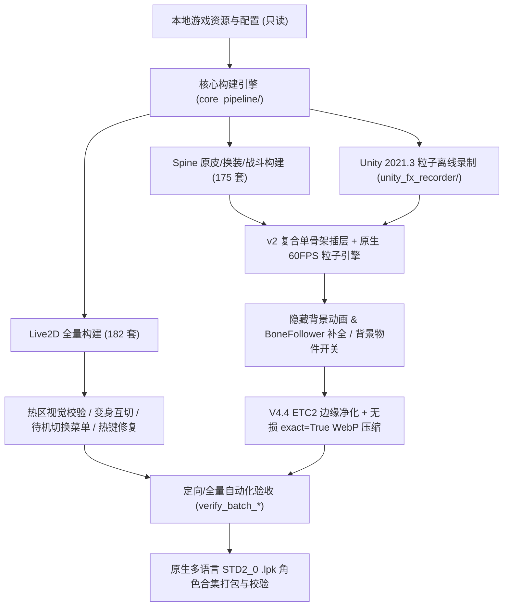

# Soul Tide Live2D & Spine Toolchain for Live2DViewerEX

面向《灵魂潮汐（Soul Tide）》全量 **55 位人偶 / 357 套皮肤（182 套 Live2D + 175 套 Spine）** 的 **Live2DViewerEX** 自动化构建、视觉校准、Unity 粒子特效重构、ETC2 纹理净化与原生多语言 `.lpk` 打包工具链。

> [!NOTE]
> **开源边界与免责声明**：本仓库**仅包含纯源码脚本（Python / C# / Unity Shader）与技术排障文档**，不包含任何游戏原始美术贴图、骨架、音频、数据库文件、已编译二进制（`.exe` / `.dll`）或 `.lpk` 成品包。运行构建流水线前需自行准备合法获取的本地游戏解包资源及正版 Live2DViewerEX 环境。

---

## 核心特性

- **Live2D & Spine 全量三/四语自动化管线**：只读解析游戏资产与 I18N 数据，自动组装 Live2D `.model3.json` 与 Spine 3.8 `.config.json`，支持中 / 英 / 日 / 繁原生多语言语音台词、嘴型同步、无干扰静默分页菜单与标准 Windows `VK_*` 热键。
- **Live2D 变身切换与持久化待机动作**：支持 `replace_tex` / 自包含子模型动作触发临时变身及 `change_model` 根目录主形态互切；基于 Live2DViewerEX `VarFloats["idle_mode"]` 实现跨重启持久化的全量 `standby*` + 情绪循环待机动作切换菜单。
- **v2 统一复合单骨架插层架构**：基于官方运行时 `art_prefabs.ab` + `SoulAction` 与 `SortedComponentOrder`，通过自研 [`spine38_binary_to_json.py`](core_pipeline/spine38_binary_to_json.py) 无损解码 Spine 3.8 二进制骨架并按全局 DFS `draw_key` 合入统一 `scene_back*` / `scene_front*` 复合骨架，突破 Live2DViewerEX 单皮肤 `<= 6` 子模型上限且保证零嵌套 `ClippingAttachment`。
- **60 FPS 原生骨骼粒子引擎 + Unity 2021 离线无缝录制**：将全库 **562 / 788（71.3%）** 待机粒子节点升级为 60 FPS 多骨环形相位中继原生 Spine 骨骼动画（大幅缩减显存与贴图体积）；其余含复杂 Shader / 拖尾 / 3D 旋转节点通过 Unity `2021.3.34f1` 离线录制（支持 `Clamp` 贴图环绕与 `Custom1XYZW`）及零交叉淡化整数周期无缝循环方案打包。
- **隐藏背景动画与 `BoneFollower` 补全**：还原列车进站/滑门、小狗头弹跳、摩天轮水平车厢、无限帧率 3D 透视接力路灯、双骨软体权重微风桃枝等原版隐藏背景动画，并补齐骨骼跟随常驻粒子。
- **V4.4 Spine ETC2 边缘净化 & 无损 `exact=True` WebP 压缩**：清除手游 ETC2 4×4 块压缩引入的 `A=0 & RGB>0` 幽灵点、`RGB > A` PMA 违例与关节灰紫虚线，同时保护 1px 连续轮廓描边、金边与水彩薄纱；全库 PNG 纹理以 `lossless=True, exact=True` 无损转码 `.webp` 并逐像素回读断言零误差。
- **运行时背景与主骨架家具物件开关**：通过 `F3` / `H` 键支持隐藏背景但保留触摸特效；针对 38 套主骨架自带背景/家具/悬浮摆件的换装皮肤，借助 EX 原生 `slot_opacities lock/set` 提供三选一菜单。
- **原生多语言 `STD2_0` `.lpk` 角色合集打包与校验**：内置四语 `Motion.Language` 融合、跨皮肤跨引擎 `.ogg` SHA-256 去重及双层完整性校验器（55 人偶总包体压至源目录约 `54.9%`）。

---

## 整体流水线架构



---

## 仓库目录结构

```text
soultide-live2d-spine-tools/
├── README.md                          # 项目说明与使用指南
├── core_pipeline/                     # 上游核心构建、渲染、热区校准与验收引擎（29 个脚本）
├── unity_fx_recorder/                 # Unity 2021.3.34f1 粒子离线录制 C# 编辑器与自定义 Shader
├── scripts/                           # 主力生产、v2 重构、粒子引擎、ETC2 净化与 LPK 打包脚本（25 个脚本）
├── research_archive/                  # 研发过程专项诊断、逆向探针与算法原型（01~05，共 199 个脚本）
│   ├── 01_heling_and_particle_fx/     # 方案一原生 Spine 粒子重构与全库 FX/Shader 普查
│   ├── 02_texture_degauze_rebake/     # 纹理去纱、AI 贴图反 UV 烘焙与色彩/边缘精修
│   ├── 03_etc2_edge_denoise_rd/       # ETC2 4×4 压缩块诊断工具与 V1~V3.3 算法原型
│   ├── 04_ex_engine_reverse_lpk/      # Live2DViewerEX 运行时探针、LPK 哈希与 WebP/PMA 分析
│   └── 05_hitarea_align_audit/        # Live2D .moc3 触控盒与 Spine 热区/布局专项审计
└── docs/
    ├── troubleshooting_manual.md      # 46 项工程排障与避坑手册（Live2D / Spine / Unity FX / LPK）
    └── workshop_55_dolls_index.md     # Steam 创意工坊 55 人偶独立合集发布索引
```

---

## 核心脚本一览

### 1. 上游核心引擎（`core_pipeline/`）

| 模块 | 代表文件 | 说明 |
| :--- | :--- | :--- |
| **公共库与数据解析** | [`soultide_common.py`](core_pipeline/soultide_common.py)、[`build_i18n_and_ogg_fleet.py`](core_pipeline/build_i18n_and_ogg_fleet.py) | 只读读取本地配置表、清洗 `{$br}` / `I18N` 标记、多路 FFmpeg `libvorbis` 音频转码与三语同步 |
| **批量构建器** | [`batch_live2d_builder.py`](core_pipeline/batch_live2d_builder.py)、[`batch_spine_builder.py`](core_pipeline/batch_spine_builder.py)、[`batch_orig_spine_builder.py`](core_pipeline/batch_orig_spine_builder.py) | 批量生成 Live2D、换装 Spine 与原皮 Spine 的 Live2DViewerEX 配置与资源目录 |
| **Spine 二进制与粒子打包** | [`spine38_binary_to_json.py`](core_pipeline/spine38_binary_to_json.py)、[`batch_fx_exporter.py`](core_pipeline/batch_fx_exporter.py)、[`build_gpu_bands_manifest.py`](core_pipeline/build_gpu_bands_manifest.py)、[`run_full_unity_v2_batch.py`](core_pipeline/run_full_unity_v2_batch.py)、[`spine_fx_submodel_packer.py`](core_pipeline/spine_fx_submodel_packer.py) | Spine 3.8 二进制无损转 JSON、Unity 粒子全模块 Spec 提取、多路隔离批录与紧裁切 Submodel 打包 |
| **视觉预览与热区/布局校准** | [`audit_live2d_touch.py`](core_pipeline/audit_live2d_touch.py)、[`fix_live2d_touch_audit.py`](core_pipeline/fix_live2d_touch_audit.py)、[`audit_spine_bg_layout.py`](core_pipeline/audit_spine_bg_layout.py)、[`fix_all_spine_bg_layouts.py`](core_pipeline/fix_all_spine_bg_layouts.py)、[`update_spine_hit_areas.py`](core_pipeline/update_spine_hit_areas.py)、[`render_spine_composite_previews.py`](core_pipeline/render_spine_composite_previews.py)、[`render_spine_touch_previews.py`](core_pipeline/render_spine_touch_previews.py)、[`_spine38_composite_renderer.cs`](core_pipeline/_spine38_composite_renderer.cs)、[`_spine38_preview_renderer.cs`](core_pipeline/_spine38_preview_renderer.cs) | 基于真实蒙皮与 Live2DViewerEX `Spine3_8` 渲染器输出合成/热区叠加图，校验并修复触控热区、语音路由与背景布局 |
| **自动化验收器** | [`verify_batch_live2d.py`](core_pipeline/verify_batch_live2d.py)、[`verify_batch_spine.py`](core_pipeline/verify_batch_spine.py)、[`doll_audit_helper.py`](core_pipeline/doll_audit_helper.py) | 支持 `--only "角色/皮肤"` 定向增量校验与全库回归校验 |

### 2. 主力生产、重构与打包脚本（`scripts/`）

| 分类 | 文件 | 说明 |
| :--- | :--- | :--- |
| **Spine v2 复合场景与粒子** | [`rebuild_all_scenes_and_fx_v2.py`](scripts/rebuild_all_scenes_and_fx_v2.py) | **主力 v2 组装器**：按 `art_prefabs.ab` + `SortedComponentOrder` 全局 DFS `draw_key` 合入 `scene_back*`/`scene_front*` 单骨架，拆分独立纯触摸子模型并多线程无损 WebP 编码 |
| | [`convert_fx_to_native_spine.py`](scripts/convert_fx_to_native_spine.py) | **60 FPS 原生骨骼粒子引擎**：多骨环形相位中继、注水式骨骼预算、解析生灭淡入淡出，供 v2 组装器直接注入复合骨架 |
| | [`patch_hidden_bg_anims_and_bone_fx.py`](scripts/patch_hidden_bg_anims_and_bone_fx.py) | 还原 4 套隐藏背景动画（含 3D 针孔透视无限帧率路灯、滑门列车、水平摩天轮等）并补齐 4 套 `BoneFollower` 常驻粒子 |
| | [`rebuild_spine_scenes_from_art_prefabs.py`](scripts/rebuild_spine_scenes_from_art_prefabs.py) | `art_prefabs.ab` / `SpriteRenderer` / 9-Slice 底层场景解析库（被 v2 组装器继承复用） |
| **纹理净化与无损压缩** | [`spine_etc2_clean_v3.py`](scripts/spine_etc2_clean_v3.py) | **V4.4 ETC2 边缘净化**：双通道防黑洞 + 全 4×4 边块净化，守护 1px 连续描边、彩色镶边与水彩薄纱，支持 `--from-backup` |
| | [`export_spine_blend_masks.cs`](scripts/export_spine_blend_masks.cs)、[`render_spine_compare.cs`](scripts/render_spine_compare.cs) | 导出 `Additive`/`Screen` 槽位 UV 保护掩码；Spine 3.8 Bilinear PMA 1:1 离屏对比渲染器 |
| | [`optimize_l2d_spine_storage.py`](scripts/optimize_l2d_spine_storage.py) | 全库 PNG 转 `lossless=True, exact=True` `.webp`（逐图回读断言零误差）与 JSON 去空白压缩 |
| **Live2D 增强与交互** | [`apply_l2d_model_switch.py`](scripts/apply_l2d_model_switch.py) | 为 4 角色 10 套皮肤配置无断音动作临时变身及根目录三语常驻主形态 `change_model` 互切 |
| | [`add_l2d_idle_switch.py`](scripts/add_l2d_idle_switch.py)、[`set_l2d_idle_standby1.py`](scripts/set_l2d_idle_standby1.py) | 统一默认 `standby1`（`FadeIn: 0`）并注入基于 `VarFloats["idle_mode"]` 的持久化全量待机动作切换菜单 |
| **Spine 菜单、热键与补建** | [`add_spine_bg_toggle.py`](scripts/add_spine_bg_toggle.py)、[`clean_spine_non_oath_menus.py`](scripts/clean_spine_non_oath_menus.py)、[`fix_all_key_triggers.py`](scripts/fix_all_key_triggers.py) | 注入三语隐藏背景及 38 套 `slot_opacities` 主骨架物件三选一开关；清理 84 套非婚皮无效誓约菜单；统一全库 Windows `VK_*` 热键 |
| | [`build_missing_battle_spines.py`](scripts/build_missing_battle_spines.py)、[`build_netsuki_s3_spine.py`](scripts/build_netsuki_s3_spine.py) | 补齐 11 套纯战斗缺失皮肤 Spine 及第 110 套换装 `梦咲音月/此情无垢`（含无限帧率双骨软体权重微风桃枝） |
| | [`unpack_orig_spine_bgs.py`](scripts/unpack_orig_spine_bgs.py)、[`mount_orig_spine_bgs.py`](scripts/mount_orig_spine_bgs.py)、[`fix_orig_bg_3dolls.py`](scripts/fix_orig_bg_3dolls.py) | 原皮 Spine 背景解包、挂载与图层对齐脚本 |
| **原生多语言 `.lpk` 打包** | [`build_and_pack_workshop_lpks.py`](scripts/build_and_pack_workshop_lpks.py)、[`pack_all_dolls_mega_lpk.py`](scripts/pack_all_dolls_mega_lpk.py)、[`verify_workshop_lpks.py`](scripts/verify_workshop_lpks.py) | 单人偶独立多语言 `.lpk`（55 包）与全 55 人偶总集包并行打包、跨皮肤 `.ogg` SHA-256 去重与四语严格对称校验 |

### 3. Unity 离线粒子录制工程（`unity_fx_recorder/`）

- [`Assets/Editor/SoulTideBatchFxRecorder.cs`](unity_fx_recorder/Assets/Editor/SoulTideBatchFxRecorder.cs)：Batchmode 批录控制器，还原粒子系统各物理/曲线模块及 `Clamp` 贴图模式。
- [`Assets/Editor/SoulTideSpineParticleExporter.cs`](unity_fx_recorder/Assets/Editor/SoulTideSpineParticleExporter.cs)：精确整数 tick 零交叉淡化无缝循环录制器（支持 `Custom1XYZW` 与多相流平滑衔接）。
- [`Assets/Shaders/SoulTideParticleAdd.shader`](unity_fx_recorder/Assets/Shaders/SoulTideParticleAdd.shader) & [`SoulTideParticleAlpha.shader`](unity_fx_recorder/Assets/Shaders/SoulTideParticleAlpha.shader)：面向 Live2DViewerEX Spine PMA 管线的双通道粒子着色器。

---

## 环境依赖

| 组件 | 推荐版本 / 说明 |
| :--- | :--- |
| **Python** | Python `3.10+`，主要第三方包：`UnityPy`、`Pillow`（需带 `libwebp` 支持）、`numpy`、`scipy` |
| **Unity Editor** | `2021.3.34f1`（仅在需要重新离线录制 GPU 复杂粒子帧时使用；Batchmode 请勿传入 `-nographics`） |
| **FFmpeg** | 含 `libvorbis` 编码器（用于人声 `.wav` -> `.ogg` 转码） |
| **.NET Compiler (`csc.exe`)** | Windows `.NET Framework 4.x`（`C:\Windows\Microsoft.NET\Framework64\v4.0.30319\csc.exe`），用于按需重编译 C# 离屏渲染/掩码工具 |
| **Live2DViewerEX** | C# 离屏渲染器与掩码导出器编译时需引用其自带的 `lw_Data\Managed\Assembly-CSharp.dll` |

> [!TIP]
> 本工具链最初在本地 Windows 环境开发，部分脚本顶部保留了默认数据路径常量（如游戏资源根目录、输出目录等）。在新的机器上运行前，请先按本地目录结构调整 [`core_pipeline/soultide_common.py`](core_pipeline/soultide_common.py) 及目标脚本头部的路径常量。

---

## 常用工作流示例

### 1. 定向增量验收（推荐）

局部修改单套或少量皮肤后，使用 `--only` 执行秒级定向验收，避免冗余全库扫盘：

```powershell
# Spine 定向验收（支持英文逗号分隔多套）
python -u core_pipeline/verify_batch_spine.py --only "梦咲音月/此情无垢,阿卡赛特/黑鲨信号"

# Live2D 定向验收
python -u core_pipeline/verify_batch_live2d.py --only "欧若拉/童话心绘"
```

### 2. Spine v2 复合场景重建、ETC2 净化与后处理

```powershell
# 定向重建指定换装 Spine 的复合场景与混合 FX
python -u scripts/rebuild_all_scenes_and_fx_v2.py --skins 1001_HagakureRuri_S2,3301_Aoling_S2 --frame-workers 6

# 全量重建后同步隐藏背景动画、BoneFollower 粒子与背景/物件开关
python -u scripts/patch_hidden_bg_anims_and_bone_fx.py
python -u scripts/add_spine_bg_toggle.py --only "阿卡赛特/黏人心机,迦瓦娜/辉芒之子"

# V4.4 ETC2 边缘净化（预检 / 从原始备份一手重修）
python -u scripts/spine_etc2_clean_v3.py --dry-run --workers 8
python -u scripts/spine_etc2_clean_v3.py --doll "神纳木弁天" --from-backup --workers 4

# 全库无损 WebP 转换与 JSON 瘦身
python -u scripts/optimize_l2d_spine_storage.py --workers 8
```

### 3. 原生多语言 `.lpk` 打包与完整性校验

```powershell
# 打包指定角色独立多语言 .lpk（去掉 --dolls 为全量 55 人偶）
python -u scripts/build_and_pack_workshop_lpks.py --dolls 和铃 --workers 8

# 单趟产出全部 55 份独立包 + 1 份全角色总集包
python -u scripts/pack_all_dolls_mega_lpk.py --workers 8

# 校验全部 .lpk 的配置结构、四语对称性、VarFloats 互斥与音频完整性
python -u scripts/verify_workshop_lpks.py
```

### 4. 按需重编译 C# 辅助渲染器（Windows）

```powershell
$csc = "C:\Windows\Microsoft.NET\Framework64\v4.0.30319\csc.exe"
$managed = "C:\Program Files (x86)\Steam\steamapps\common\Live2DViewerEX\bin\lw\lw_Data\Managed"

& $csc /nologo /optimize+ /r:"$managed\Assembly-CSharp.dll" /r:System.Drawing.dll /out:export_spine_blend_masks.exe scripts/export_spine_blend_masks.cs
& $csc /nologo /optimize+ /r:"$managed\Assembly-CSharp.dll" /r:System.Drawing.dll /out:render_spine_compare.exe scripts/render_spine_compare.cs
```

---

## 配套文档

- **[Live2D & Spine 制作问题排查与避坑手册](docs/troubleshooting_manual.md)**：系统收录全链路构建中实证定位与解决的 **46 类典型工程问题**（含 Submodel 缩放/偏移、Live2D 控制器与 `VarFloats`、Unity Batchmode 与 PMA 着色器、ETC2 压缩块边缘伪影、WebP `exact=True`、6 子模型上限复合合并、零交叉淡化无缝粒子、`slot_opacities` 锁定恢复及 `.lpk` 四语融合陷阱）及标准验收检查表。
- **[Steam 创意工坊 55 人偶发布索引](docs/workshop_55_dolls_index.md)**：全量 55 位人偶独立多语言合集（357 套皮肤）的 Steam 创意工坊直达链接、分级与体积清单。
